### Hello there, I am <a href="https://roni.rocks/" target="_blank" >Roni a software engineer who loves the space between design and code.</a>

~ "Life is either a daring adventure or nothing at all." ~ Helen Keller
 

🛠️ Previously 4+ years at Postman, where I grew from IC to tech lead on the State of the API Report.

🏀 Currently building SheRules and SheKnows, women’s sports apps that make rules and facts easy to understand.

🔍 Looking for my next design engineer or frontend role at a mission-driven team.

## Philosophy
**Why I build:** To help people. It used to be hands-on; now it's through what I ship.

**How I build:** Component-driven, user-first, accessible by default. AI writes a lot of my first drafts, and I review every line like a teammate's PR. The pace changed, not the care.

###  Some tech I work with:

 

<!-- ## Games
[][js] -->

 
 

### Random

  
🔥 Contribution Streak

  

  
😄 Here is cute pup photo for you, to make your day better

   

 

### Connect with me &nbsp;&nbsp;
[][website]
&nbsp;
[][linkedin]
&nbsp;

 
 

[sanity]: https://template-slicks-slices.netlify.app/
[website]: https://roni.rocks
[twitter]: https://twitter.com/Bluesky_roni
[linkedin]: https://www.linkedin.com/in/roni-lockwood/
[tafthill]: https://tafthillacres.com
[sass]: https://github.com/OlliesWorld/FMEasyBank
[react]: https://github.com/OlliesWorld/pic_some
[js]: https://olliesworld.rocks/games.html
[netlify]: https://roni.rocks
[email]: rtlockwoodwork@gmail.com
[studio]: https://code.visualstudio.com/
[html]: https://kids.kiddle.co/HTML
[css]: https://developer.mozilla.org/en-US/docs/Web/CSS

 
 

<picture>
  <source media="(prefers-color-scheme: dark)" srcset="https://raw.githubusercontent.com/OlliesWorld/OlliesWorld/output/puzzle-bobble-contribution-graph-dark.svg">
  <source media="(prefers-color-scheme: light)" srcset="https://raw.githubusercontent.com/OlliesWorld/OlliesWorld/output/puzzle-bobble-contribution-graph.svg">
  
</picture>

Each bubble is a day I shipped code.
